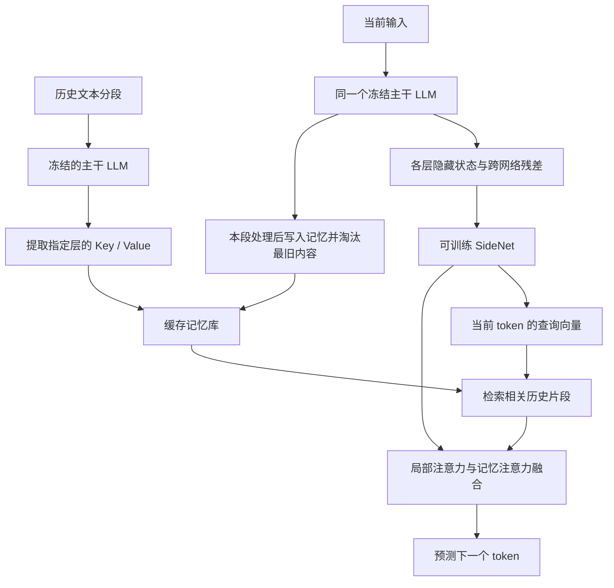

# 《Augmenting Language Models with Long-Term Memory》论文解读

> 来源：当前目录同名 PDF，14 页，NeurIPS 2023。作者：Weizhi Wang、Li Dong、Hao Cheng、Xiaodong Liu、Xifeng Yan、Jianfeng Gao、Furu Wei。机构：加州大学圣塔芭芭拉分校、微软研究院。
> 本文按“主题—问题—方法—实验—局限—启发”整理。页码指 PDF 页码；工程建议与延伸思考会单独标明，不作为论文已经证明的结论。

## 1. 一句话理解

**LONGMEM 用冻结的大模型把历史文本编码成稳定的注意力键值记忆，再训练一个旁路网络 SideNet，按当前需求检索、读取和融合这些记忆，让模型利用超出当前输入窗口的历史信息。**

它最重要的设计不是单纯增加存储容量，而是将“写入记忆的编码器”与“使用记忆的网络”解耦。

## 2. 论文主题与研究问题

论文研究的是：**有限上下文窗口的语言模型，如何借助外部记忆利用长文本历史，并提升语言建模和上下文学习能力？**

主要有三个障碍：

1. **输入窗口有限。** 长书、长论文和大量示例无法一次装入模型；早期背景、人物关系或示例标签因此无法被直接利用。
2. **直接扩大窗口代价高。** 标准密集自注意力的计算复杂度随序列长度呈平方增长，训练与显存成本增加。
3. **缓存记忆会发生表示失配。** 若同一个持续更新的模型同时生成记忆和读取记忆，旧缓存由旧参数生成，当前查询由新参数生成，两者的表示空间可能逐渐不一致。

第三点就是论文强调的 **memory staleness（记忆陈旧问题）**。这里主要指向量表示随模型更新而失配，不是现实世界中的知识过期。（第 1—2 页）

## 3. 作者的思考路线

论文的推导可以按以下链条理解：

1. 模型不必每次重新处理全部历史，可以把历史保存在外部记忆中。
2. 当前生成只需要历史中的相关部分，因此可以检索，而非对全部历史做密集注意力。
3. 如果编码器持续变化，旧缓存难以与新查询保持一致。
4. 因此冻结编码器，固定记忆的表示基础。
5. 冻结主模型后，需要另一个可训练组件学习如何使用记忆，于是引入 SideNet。
6. SideNet 同时接收主模型的当前输入表示和检索出的历史记忆，以兼顾原有语言能力与长期上下文。
7. 通过普通的下一 token 预测训练，让它学会检索后的记忆融合，再测试能否迁移到长文本理解和多示例学习。

**关键想法：稳定性由冻结主干负责，适应性由可训练旁路负责。**

## 4. 核心架构：三个组件分别做什么

| 组件 | 是否训练 | 作用 |
|---|---|---|
| Backbone LLM，主干语言模型 | 记忆增强适配阶段冻结 | 编码历史文本并产生记忆；为当前输入提供各层隐藏状态 |
| Cache Memory Bank，缓存记忆库 | 非可微缓存，不通过反向传播训练其中的历史条目 | 保存历史 token 的注意力 Key/Value，支持检索和队列更新 |
| Residual SideNet，残差旁路网络 | 可训练 | 生成检索查询，读取历史记忆，融合当前上下文并输出预测 |

主模型仍然需要做前向计算。冻结的含义是“不更新它的参数”，不是“运行时不使用它”。最终预测来自 SideNet 的最后一层表示，并复用冻结的语言模型输出头。（第 3—5 页）

### 4.1 数据如何流动



## 5. 方法细节

### 5.1 记忆保存的是注意力 Key/Value

历史文本先经过冻结主干，从某一 Transformer 层提取注意力键值对并缓存。

- Key 用于与当前查询匹配，寻找相关历史。
- Value 提供被检索到的历史表示，参与注意力计算。
- 这些表示是模型内部向量，不是可以直接展示给用户的原文摘要。
- 记忆在注意力头维度上组织，属于模型内部的记忆增强机制。

论文实现从主干第 18 层提取记忆，在 SideNet 第 9 层融合记忆。（第 6 页）

### 5.2 用 Token-to-Chunk 检索兼顾效率和局部完整性

每个当前 token 都可以发起独立的历史检索，但检索对象先按连续短片段组织：

1. 将历史键值对分成长度为 `csz` 的连续 token 块。
2. 对块中的 Key 做均值池化，得到块级检索向量。
3. 用当前 token 的 Query 与块级 Key 做内积匹配。
4. 选择最相关的 `K / csz` 个块。
5. 将这些块展开为 `K` 个 token 级键值对，供记忆注意力使用。

训练配置为 `csz = 4`、`K = 64`，因此每个当前 token 检索 16 个片段，共 64 个历史 token 的键值对。片段组织减少索引条目，也避免完全依赖孤立 token 的召回。

**这里的 chunk 是几个 token 的微小片段，不能直接等同于常见文档 RAG 中数百字的文本块。**

### 5.3 通过门控融合当前上下文和历史记忆

SideNet 的记忆增强层分别计算：

- `A`：对当前输入窗口进行局部自注意力得到的结果。
- `M`：对检索出的历史键值对进行注意力计算得到的结果。

融合方式为：

```text
融合输出 = sigmoid(g) × A + (1 − sigmoid(g)) × M
```

`g` 是按注意力头设置的可训练门控参数。它让网络学习如何平衡局部上下文与历史信息。论文并未把这个门控定义为逐条记忆的事实可信度评分。（第 5 页，公式 2—3）

### 5.4 SideNet 如何继承主模型能力

SideNet 的层数为主干的一半，并从主干对应深度的层初始化参数。另一个关键设计是跨网络残差连接：

```text
SideNet 第 l 层状态
  = SideNet 本层计算结果
  +（主干第 2l 层状态 − 主干第 2l−2 层状态）
```

这样传给 SideNet 的是主干跨越两层产生的表示增量。SideNet 保留自身 Transformer 内部的常规残差连接，同时额外接收主干知识。（第 4—5 页，公式 1）

### 5.5 训练和记忆更新必须保持时间因果顺序

模型使用标准的自回归下一 token 预测目标训练 SideNet，不需要为每条记忆人工标注“应该何时被使用”。

但数据不能像普通语言模型训练那样任意打乱所有片段：同一文档的连续片段必须按顺序进入连续批次，保证当前片段检索的是过去信息。

记忆库采用有限容量队列：先使用已有历史完成当前处理，再加入当前片段，移除最旧片段。否则可能把当前或未来内容提前泄漏到检索结果中。（第 4、6 页）

## 6. 实验配置：理解结论的边界

| 项目 | 论文设置 |
|---|---|
| 主干 | 作者复现的 GPT-2*，407M 参数，采用 ALiBi 位置编码 |
| 主干结构 | 24 层，隐藏维度 1024，16 个注意力头 |
| SideNet | 12 层，151M 参数 |
| 总参数 | 558M |
| 当前输入窗口 | 1024 tokens |
| 记忆容量 | 65,536 个 token 的键值对 |
| 每 token 检索量 | 64 个历史 token 的键值对 |
| 检索实现 | GPU FAISS 内积精确检索 |
| 主干预训练量 | 117B tokens |
| 记忆增强适配训练量 | 26B tokens |
| 训练设备 | 16 张 32GB Tesla V100 |

数据来源为 The Pile 的部分子集。对照模型包括 GPT-2*、Memorizing Transformer（MemTRM）和 TRIME。（第 6 页、附录 C）

虽然 SideNet 比主干小，但仍有 151M 可训练参数，并经历 26B tokens 的适配训练。因此“轻量”是相对于更新整个主干而言，不意味着无需训练或仅添加一个很小的插件。

## 7. 主要实验结果

### 7.1 长文本语言建模：困惑度降低

困惑度 PPL 越低，说明模型对下一个 token 的预测越好。表中为原文表 2 的结果：

| 数据集或长度分组 | GPT-2 | MemTRM | TRIME | LONGMEM |
|---|---:|---:|---:|---:|
| PG-22，5K–10K | 22.78 | 21.77 | 22.21 | **21.29** |
| PG-22，10K–100K | 24.39 | 23.56 | 23.50 | **23.01** |
| PG-22，100K–500K | 24.12 | 23.23 | 23.74 | **22.55** |
| PG-22，500K–1M | 24.97 | 24.16 | 24.32 | **23.35** |
| PG-22，大于 1M | 18.07 | 17.39 | 17.80 | **16.71** |
| ArXiv | 11.05 | 10.81 | 10.95 | **10.05** |

**结论：** 在这些评测中，LONGMEM 比不带记忆和其他记忆增强基线都更有效。

需要注意两个细节：

- 按表 2 逐项相减，PG-22 相对 GPT-2* 的 PPL 改善范围为 **1.36–1.62**；正文写作 1.38–1.62，与表格存在小差异，这里以表格为准。
- 大于 1M tokens 的分组只有 **1 本书**，不能将该组结果理解为充分覆盖了百万 token 文档场景。（第 7—8 页，表 1—2）

### 7.2 ChapterBreak：利用前文判断下一章开头

任务要求从同一本书的多个候选片段中，选择真正的下一章开头，比局部文本续写更依赖长程背景。

| 模型 | 4K 前文 | 6K 前文 | 8K 前文 |
|---|---:|---:|---:|
| GPT-2* | 18.4% | 18.4% | 18.4% |
| MemTRM | 28.3% | 28.7% | 28.7% |
| LONGMEM | **37.7%** | **39.4%** | **40.5%** |

8K 前文条件下，LONGMEM 比 MemTRM 高 **11.8 个百分点**。随着前文增加，准确率上升，支持“模型确实在利用更长历史”的判断。

论文还列出引用自既有工作的 GPT-3 175B 的 28% 结果。这个比较只适用于所报告的特定评测设置；不同模型可用上下文和评测来源存在差别，不能推出 LONGMEM 的通用能力超过 GPT-3。（第 8 页，表 3）

### 7.3 上下文学习：示例可以放入记忆库

传统 few-shot 学习把示例全部放进提示词，数量受窗口限制。论文将额外示例编码进记忆库，使当前窗口中的少量示例与历史示例共同发挥作用。

在 SST-2、MR、Subj、SST-5、MPQA 五个分类数据集上：

| 配置 | GPT-2 | MemTRM | TRIME | LONGMEM |
|---|---:|---:|---:|---:|
| 当前窗口 4 个示例；记忆模型另有 2000 个示例 | 55.6% | 55.6% | 56.0% | **58.4%** |
| 当前窗口 20 个示例；记忆模型另有 2000 个示例 | 58.7% | 58.6% | 61.1% | **66.7%** |

20-shot 条件下，LONGMEM 比 GPT-2* 高 **8.0 个百分点**，比 TRIME 高 **5.6 个百分点**。这两个基线差值不能混用。

SQuAD 使用当前窗口 3 个示例、记忆库额外 200 个示例：

- 精确匹配 EM：GPT-2* 为 22.28，LONGMEM 为 **26.77**，提高 4.49 分。
- F1：GPT-2* 为 30.78，LONGMEM 为 **35.70**，提高 4.92 分。

**结论：** 记忆库不仅能保存文章历史，也能保存任务示例，扩展上下文学习可利用的监督信息。这里是无任务专属微调的评测，不代表整个模型从未经过训练。（第 8—9 页，表 4—5）

### 7.4 消融：提升是否真的来自记忆

在推理时清空记忆，但保留主干与训练好的 SideNet：

- 20-shot 五任务平均准确率从 **66.7% 降到 59.4%**，减少 7.3 个百分点。
- 4-shot 从 **58.4% 降到 55.7%**，减少 2.7 个百分点。

这说明收益不能只用“增加了 SideNet 参数”解释，检索到的历史记忆本身也有贡献。

另两项观察：

1. **检索粒度要适配任务。** 分类任务更依赖细粒度标签信息，实验中 `csz = 2` 的效果更好。
2. **记忆容量并非越大越好。** 推理时比较 8K、16K、32K、65K 容量，在部分书籍长度条件下，16K 的结果更好，应结合数据长度选择。

原文关于 chunk-size 的候选值存在不一致：第 9 页正文写 `{2,4,8}`，第 10 页图 4(a) 图例写 `{1,2,4}`。二者都支持作者所述“2 的表现最好”，但复现完整设置时应进一步核对代码。（第 9—10、13 页）

### 7.5 效率：有优势，也有检索成本

附录 B 比较了密集自注意力 GPT-2* 与 LONGMEM：

| 总上下文配置 | 模型 | 推理吞吐量 tokens/s | GPU 显存 MB |
|---|---|---:|---:|
| 4K | GPT-2*：4K 当前窗口 | 14,666 | 20,671 |
| 4K | LONGMEM：1K 当前窗口 + 3K 记忆 | **22,638** | **13,335** |
| 8K | GPT-2*：8K 当前窗口 | 8,417 | 54,195 |
| 8K | LONGMEM：1K 当前窗口 + 7K 记忆 | **21,343** | **13,437** |

8K 对照中，LONGMEM 吞吐量约为 2.54 倍，显存减少约 75.2%。这些是论文具体配置下的结果，不能直接当作聊天服务的单请求生成速度。

检索也有成本：论文报告每 1K tokens 的检索约耗时 15ms，相当于主干前向耗时的 55%。因此真正的权衡是“检索与旁路计算”换取“避免对全部历史做密集注意力”，而不是免费增加上下文。（第 6、13 页）

## 8. 与长窗口、RAG、微调有什么区别

以下是帮助理解的机制对照，不是论文对现代系统的全面评测。

| 方法 | 信息放在哪里 | 如何使用 | 主要代价或限制 |
|---|---|---|---|
| 直接扩大上下文窗口 | 当前输入序列 | 对窗口内内容做注意力计算 | 长序列计算与显存成本 |
| 常见文本 RAG | 外部原文、文本块与索引 | 检索文本后拼入提示词 | 检索质量、提示词容量、原文组织 |
| LONGMEM | 主模型内部注意力 Key/Value 缓存 | SideNet 在隐藏层检索并融合 | 需要访问模型内部表示并训练 SideNet |
| 参数微调 | 模型参数 | 通过参数变化影响输出 | 更新成本，以及知识定位和撤销困难 |

LONGMEM 与 RAG 都借助外部检索，但接口层次不同。只有封闭模型 API、无法访问内部注意力层时，通常不能原样实现这套架构；可以借鉴其设计原则构建文本记忆系统。

## 9. 最值得记住的贡献

1. **编码与读取解耦。** 用稳定的编码器避免缓存随模型参数更新而失配，用可训练读者学习使用历史。
2. **残差 SideNet。** 既接收主模型逐层表示增量，又学习记忆融合，减少对主干参数的直接改动。
3. **Token-to-Chunk 检索。** 当前 token 按需查找历史短片段，再恢复到 token 级注意力。
4. **将示例库变成上下文学习的一部分。** 当前输入只放少量示例，更多示例通过记忆检索参与预测。
5. **记忆训练必须与数据时序一起设计。** 记忆结构、批次构造和因果约束是一个整体。

## 10. 局限与容易误读之处

- **长期不等于永久。** 实现使用约 65K 的有限队列，旧内容会被淘汰；它并不是无限存储所有历史的数据库。
- **可处理长输入流，不等于同时完整注意到任意长历史。** 当前 token 只读取有限数量的检索结果。
- **冻结解决的是表示稳定性。** 事实更新、错误记忆、互相冲突的知识、用户主动删除等问题，并未因此自动解决。
- **冻结主干不代表整体行为完全不变。** 主干参数保留，但最终输出受到训练后的 SideNet 影响。
- **收益具有任务与规模边界。** 主要实验证据来自约 558M 总参数模型，以及长文本建模、章节识别、分类和问答任务。
- **不能直接推导为成熟的个人助理记忆。** 跨会话身份、偏好管理、权限隔离、记忆删除和长周期任务状态，不是本文验证的重点。
- **检索失败仍会限制效果。** 记忆存在不代表一定被召回，召回也不等于一定被正确使用。
- **部分结果有较大随机波动。** 上下文学习报告了 6 个随机种子的均值和标准差，不能只看平均分忽略稳定性。

## 11. 可借鉴的工程想法与实践思路

> 本节是基于论文的延伸思考，不是作者已经实现或实验证明的功能。

### 11.1 把“保存什么”和“怎样利用”分开设计

应用级记忆系统可以分为两个层次：

- **稳定存储层：** 保存原始信息、来源、版本、时间、所属用户和任务。
- **可迭代使用层：** 根据当前任务调整召回、重排序、筛选和提示词组织策略。

这样能够在改进读取策略时保留历史数据。如果更换向量编码模型，应记录编码器版本并考虑重新索引，避免不同表示空间混用。

### 11.2 根据任务选择记忆粒度

- 查字段规则或错误码：小块精确召回更有价值。
- 总结完整业务流程：需要较大上下文，保留前置条件和步骤依赖。
- 查历史项目决策：需要结论、原因、适用范围和来源一起返回。

论文中细粒度标签任务受益于小 chunk，这启发我们按任务调粒度，但不能照搬“2 tokens”到所有知识库。

### 11.3 为工作助手建立三类记忆

| 类型 | 示例 | 建议策略 |
|---|---|---|
| 当前任务上下文 | 本轮需求、待修改章节、操作进度 | 保持精确、及时更新 |
| 可检索历史 | 项目文档、操作手册、已完成案例 | 带来源索引、按需召回 |
| 已确认的稳定约定 | 文档代称、常用目录、明确的软件偏好 | 单独结构化记录，支持修改与删除 |

例如，MES 文档助手可以记录“XXX系统学习指导”和“MES-传统”的对应关系，再针对抽检模块任务检索相关章节；但真实文档内容仍应读取最新版本，不能把历史缓存当成当前事实。

### 11.4 评估重点应是“用对记忆”，而不只是“存了多少”

可以设计以下测试：

1. 当前问题是否召回正确的历史来源？
2. 记忆库加入相似但无关的内容后，回答是否变差？
3. 新规则替代旧规则时，能否采用最新有效版本？
4. 删除某条记忆后，是否停止召回并使用它？
5. 关闭记忆后表现下降多少，收益是否确实来自记忆？
6. 延迟、索引成本和显存增长是否值得所获得的准确率提升？

这延续了论文通过“去掉记忆”的消融实验来证明贡献的思路。

## 12. 速记卡与回读路径

**主题：** 用长期外部记忆突破固定上下文窗口。

**问题：** 长输入成本高；持续更新的编码器会使旧缓存表示失配。

**方案：** 冻结主干编码历史，训练 SideNet 检索与融合历史 Key/Value。

**流程：** 分段编码 → 保存键值 → 当前 token 检索短片段 → 门控融合 → 预测 → 更新记忆队列。

**关键结果：** ChapterBreak AO3 的 8K 条件准确率 40.5%；20-shot 五任务平均准确率 66.7%，清空记忆后为 59.4%。

**实践启发：** 存储稳定性与读取适应性分开，记忆容量和粒度按任务调整，用消融和成本指标验证价值。

| 想回看什么 | 原文位置 |
|---|---|
| 动机、解耦架构 | 第 1—3 页，图 1—2 |
| SideNet、残差连接、检索与融合公式 | 第 4—5 页，第 2 节 |
| 批次构造、训练和检索配置 | 第 6 页，图 3 |
| 长文本和章节识别结果 | 第 7—8 页，表 1—3 |
| 分类与问答上下文学习 | 第 8—9 页，表 4—5 |
| 粒度、容量消融 | 第 9—10 页，图 4 |
| 去掉记忆与效率比较 | 第 13 页，表 6—7 |
| 完整训练参数和提示模板 | 第 14 页，表 8—9 |

论文代码入口（原文提供）：https://aka.ms/LongMem
